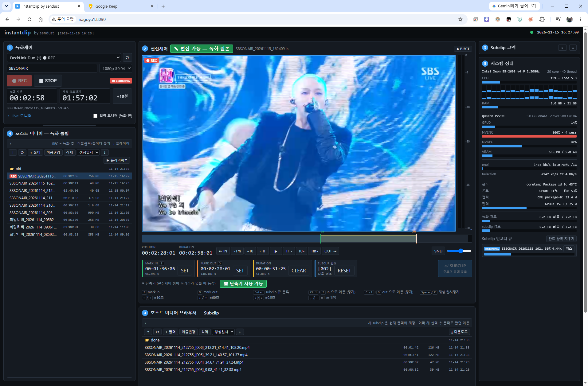
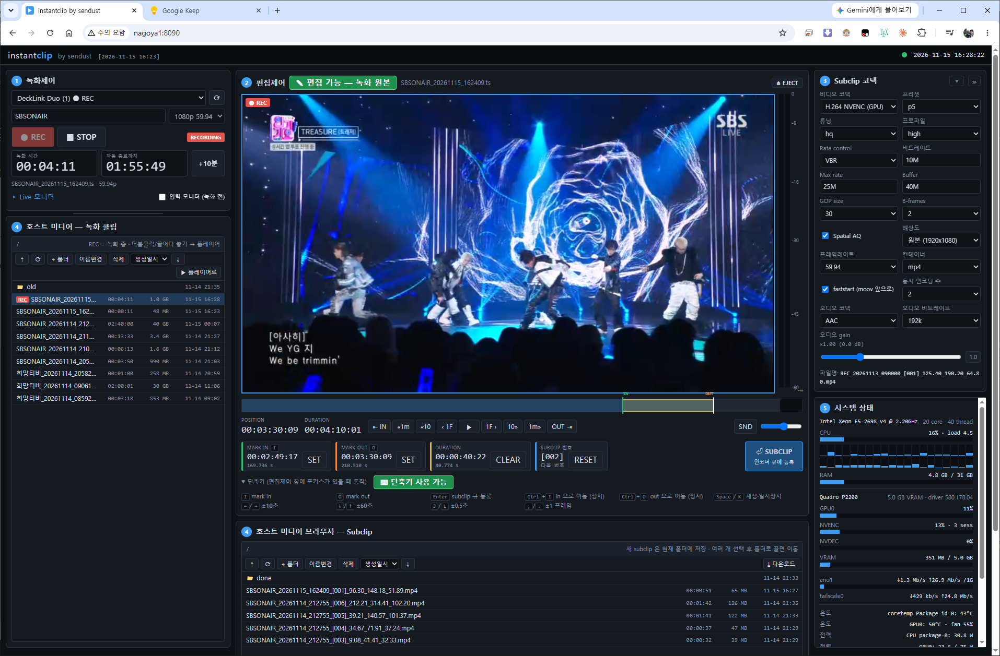
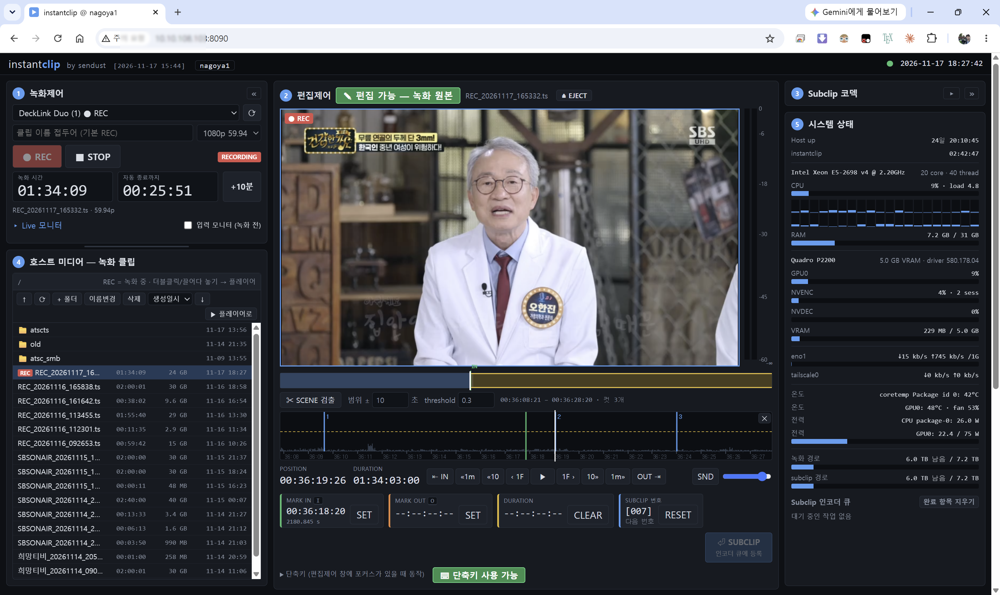

# instantclip

**English** | [한국어](README.ko.md)

A system for cutting subclips from clips that are being recorded (or already recorded) from DeckLink: watch them in a
remote web browser, set mark in / mark out, and get a frame-accurate subclip.





```
SDI 1080i59.94 2ch ─ DeckLink ─ ffmpeg (1 process / channel)
                                 ├─ bwdif_cuda → hires 1080p59.94 / 29.97 4:2:0 MPEG-2 35 Mbps CBR (CPU)  <record>/<name>.ts
                                 ├─ 480p29.97 H.264 4 Mbps HLS(EVENT)                    <proxy>/<name>/index.m3u8
                                 ├─ thumbnails 160x90, every 2 s                          <thumbnail>/<name>/NNNNNN.jpg
                                 └─ live 640x360 H.264 + Opus → mediamtx RTSP → WebRTC(WHEP) → recording-control monitor
Browser editor ─ proxy HLS (hls.js) playback → mark in/out → Enter
                                         → encoder queue → frame-accurate re-encode from hires → <subclip>/
```

- Editing uses the low-resolution proxy; subclips are made from the high-resolution hires file. Both come out of the same
  filter graph of the same ffmpeg, so the same picture carries the same timestamp. The encoder turns each mark into the
  timestamp of the frame the editor showed at that spot, seeks the input 5 s earlier and then cuts exactly at that
  timestamp with `trim`/`atrim` (from the in frame up to the frame just before out = exactly what the editor showed,
  audio and video both starting at 0).
  Cutting with input `-ss`/`-t` alone would start at the next decodable frame after the seek point (up to one GOP, 0.5 s)
  and shift the whole subclip.
  With a 59.94 source, one editor frame is two source frames and the editor shows the later one. When a cut falls between
  those two frames (on a field boundary), the in point moves one source frame later so that one frame of the previous
  scene does not sneak in at the start of the subclip.
- Clips that are still recording can be opened and edited right away, because the proxy is an HLS EVENT playlist; the
  length grows automatically. A subclip of a recording source waits as `WAITING` until its out point has been written to
  the hires file, then encodes.
- Files not recorded by this system (mp4/mov/mxf etc. copied in from elsewhere) get a proxy and thumbnails generated
  automatically when sent to the player.

## Running

```bash
./run.sh                    # first run creates .venv and installs requirements
# http://<host>:8090/
```

As a service (needs sudo):

```bash
sudo cp deploy/instantclip.service /etc/systemd/system/
sudo systemctl daemon-reload && sudo systemctl enable --now instantclip
journalctl -u instantclip -f
```

CPU power (W) display — RAPL is readable only by root by default:

```bash
sudo cp deploy/rapl-read.conf /etc/tmpfiles.d/ && sudo systemd-tmpfiles --create /etc/tmpfiles.d/rapl-read.conf
```

Copying to another server and restarting it there (needs ssh key login; the remote's `config.json`, venv, logs and
state files are left alone; refuses while the remote is recording or encoding):

```bash
deploy/push.sh [--force] [user@]host [remote dir, default ~/instantclip]
```

Requirements: ffmpeg (`--enable-decklink --enable-ffnvcodec --enable-cuda-nvcc --enable-libopus --enable-libx264`),
mediamtx (RTSP :8554, WebRTC :8889 + UDP :8189 — open these in the firewall to see the live monitor from a remote
browser), NVIDIA driver.

## Configuration `config.json`

`config.json` holds this server's operating settings and is not tracked by git (`.gitignore`). The repository has only
the template `config.example.json`; if `config.json` is missing it is created from the template on first start (keys
missing from the template too are filled with the defaults in code).
Subclip codec settings in the UI are saved to this file as soon as they change. Everything else: edit the file and restart.

| Section | Contents |
|---|---|
| `http.port` | Web UI port (default 8090) |
| `paths.record / proxy / subclip / thumbnail` | Recording, proxy, subclip and thumbnail paths |
| `capture` | DeckLink `format_code` (Hi59 = 1080i59.94), audio channels, deinterlace filter, default recording frame rate `fps` (60000/1001 or 30000/1001), recording file name pattern (`{prefix}` + strftime), auto stop `auto_stop_sec` (7200 = 2 h), extension step `extend_sec` (600), `device_nodes` device name → `/dev/blackmagic/ioN` (to detect use by other processes; corrected automatically each time this system captures) |
| `record_hires` | High-resolution recording codec. Default `mpeg2video` 35M CBR (minrate=maxrate=bitrate), GOP 30, B 2, `threads`, `extra_args` (intra_vlc, non_linear_quant, qmin/qmax). Can be switched to `h264_nvenc`/`libx264` |
| `record_proxy` | Low-resolution recording codec (854x480, 29.97, 4M, HLS segment length) |
| `live` | Encoding for the WebRTC monitor |
| `editor` | Arrow-key seek times (s): `seek_lr` ←/→ (default 10), `seek_ud` ↓/↑ (default 60); the buttons show these values too. Scene detection defaults `scene_range` (± s, 5), `scene_threshold` (0.3). Decode TS without a proxy in the browser: `browser_decode` (true), its quality `ts_quality` (`full` / `half` / `quarter`, default full — half and below use MPEG-2 lowres decoding, which turns small captions into blocks), number of decode workers `ts_workers` (0 = auto, CPU cores − 2, 2–4) |
| `thumbnail` | Thumbnail interval/size |
| `subclip` | Subclip codec (h264_nvenc / hevc_nvenc / libx264, preset, rc, bitrate, GOP, faststart, audio, gain), `name_template`, concurrent encodes `workers` (changed in the UI, applied immediately), deinterlace filter for interlaced sources `deinterlace` (`bwdif` / `yadif`, changed in the UI — appears in the codec panel when an interlaced source is open) |
| `mediamtx` | RTSP address, WebRTC address/port (if `webrtc_url` is empty: `browser host:webrtc_port`) |
| `log` | Log path/level/rotation |

Subclip names: `name_template` = `{src}_[{n:03d}]_{start:.2f}_{end:.2f}_{dur:.2f}`
→ `sourceclip_[N]_start_end_duration.mp4` (e.g. `REC_20261113_090000_[001]_125.40_190.20_64.80.mp4`).
N is a per-source counter stored in `state.json`. A source without a counter starts at the highest existing number in
the subclip folder (including older names without brackets) + 1.
RESET in the edit panel restarts that source's counter at [001] (counters are shared by all users; when anyone uses a
number or resets, the next number on every screen updates within a second). If a file with the same name already
exists it is not overwritten; `-2`, `-3` … is appended.

NVENC does not support MPEG-2, so it is encoded on the CPU (measured: 1080p59.94 35 Mbps in real time at 60 fps, 0 drops).
1080p59.94 exceeds the standard sample-rate limit of MPEG-2 Main@High, but common decoders such as ffmpeg/NVDEC play it fine.

## Screen

`[YYYY-MM-DD HH:MM]` next to the logo at the top left is the last commit time of the code checked out when the server
started; next to it is the server hostname (the browser tab title is `instantclip @ hostname` too).

```
┌ Recording ───┐┌ Edit control ────────────┐┌ Subclip codec┐
│              ││                          ││              │
├╌╌╌(drag)╌╌╌╌╌┤│                          │├ System status┤
│ Rec clips    │├ Media browser: Subclip   ┤│ + enc. queue │
└──────────────┘└──────────────────────────┘└──────────────┘
```

1. **Recording control** — DeckLink selection, prefix, recording frame rate, REC/STOP, live monitor (400 px, WebRTC), dBFS level meter.
   Frame rate: 1080p 59.94 (one frame per field, bwdif mode=1) or 1080p 29.97 (one frame per frame, mode=0).
   Chosen per recording and remembered by the browser (initially `capture.fps`). It cannot be changed while recording
   and is shown next to the clip name.
   `«` at the right of the title folds the left column (recording control + recorded clips) into a thin strip at the
   edge; clicking the strip unfolds it (the edit panel gets that much wider; remembered by the browser; not present at
   screen widths of 1050 px or less). Recording continues while folded and the strip shows `● REC`.
   REC stops automatically after 2 hours (in case a recording is left running unattended). `+10분` extends it;
   recording time and time left until auto stop are shown at the same size (yellow under 10 minutes, blinking red under 3).
   The horizontal line between recording control and the recorded clip list below can be dragged to change the height
   (double-click: default; remembered by the browser).
   Sound starts muted (MUTE) and plays only after pressing the button. ▾ folds the monitor and also closes the WebRTC connection.
   `입력 모니터` (input monitor) shows the input even before recording (it holds the DeckLink device while on).
   Devices used by another process (mediarouter etc.) are shown greyed out as `— 사용 중` (in use) and cannot be
   selected; REC and input monitor are refused too (checked every 2 s via `/proc/*/fd`; only processes of the same user
   account are visible).
   On the Duo 2, the device node order differs from the list order (Duo (2)=io2, Duo (3)=io1).
2. **Edit control** — drag a clip from the media browser and drop it, or double-click it. It opens paused on the first frame.
   `⏏ EJECT` at the right of the title unloads the clip and returns to an empty player (the clip's marks are remembered
   and restored when it is opened again).
   After opening a subclip to check the result, `↩ 녹화클립 로드` (load recorded clip) reopens the last recorded clip
   at the same playhead position (shown when something other than a recorded clip is open or after EJECT; remembered
   with the session across reloads).
   Timeline hover = thumbnail, IN/OUT range shown; mark times are remembered per clip by the browser.
   The SUBCLIP number box shows the next number, and RESET restarts at [001].
3. **Subclip codec** — saved to `config.json` as soon as it changes. Concurrent encodes are set here too (applied to running jobs immediately).
   Frame rate is 59.94 / 29.97. When a 29.97 recording is loaded in the edit panel, it is locked to 29.97
   (the encoder never converts to a higher frame rate than the source, so a subclip of a 29.97 source is 29.97 even if the setting is 59.94).
   `»` at the right of the title folds the right column (codec + system status) into a thin strip at the edge; clicking
   the strip unfolds it (edit panel and browser get that much wider; remembered by the browser).
   `▾` folds the settings up to the title bar (like the live monitor; system status gets that much taller; remembered by
   the browser). At screen widths of 1500 px or less only `▾` is present.
4. **Media browser** — recorded clips (REC = recording) below recording control; subclips in the wide list below the
   edit panel. New folder, rename (F2), delete (Del), Ctrl/Shift multi-select, subclip download. New subclips are saved
   in the current folder of the right-hand panel.
   Sorting: name / creation time (file modification time), ↓↑ button reverses (remembered per panel by the browser).
   Moving: drag items (several if selected) onto a folder row to move them into it, or onto the `↑` button to move them to the parent folder.
   If even one name already exists at the target, nothing is moved. A subclip being encoded cannot be moved or deleted.
   Renaming/deleting a recorded clip also handles its proxy and thumbnails; a clip being recorded and the sources of
   waiting/encoding subclip jobs cannot be changed or deleted.
5. **System status** (below the codec panel) — host uptime, instantclip process uptime, CPU (per core), RAM,
   GPU/NVENC/NVDEC/VRAM, NIC utilization, temperatures, power, free disk space, encoder queue (most recently added job
   on top, progress, cancel).

### Shortcuts (when focus is anywhere in the edit control panel — green "단축키 사용 가능" next to the shortcut help line; red "단축키 꺼짐" when focus leaves the panel)

| Key | Action | Key | Action |
|---|---|---|---|
| `I` | mark in | `O` | mark out |
| `Ctrl+I` | go to mark in and pause | `Ctrl+O` | go to mark out and pause |
| `Enter` | add subclip to the encoder queue | `Space` / `K` | play/pause |
| `←` `→` | ∓`editor.seek_lr` s (default 10) | `↓` `↑` | ∓`editor.seek_ud` s (default 60) |
| `J` `L` | -0.5 / +0.5 s | `,` `.` | -1 / +1 frame |
| `Home` | go to the first frame and pause | `End` | go to the last frame and pause |
| `/` | scene change detection (same as the `✂ SCENE 검출` button) | | |
| `1`–`9` | while the detection strip is open: go to cut N (first frame of the new scene) and pause | `Shift+1`–`9` | go to cut N − 1 frame (last frame of the previous scene) — for finding out points |

Keys are matched by `KeyboardEvent.code`, so they work with the Korean input method active too.
The mark in frame is included in the subclip and the mark out frame is not (duration = out − in frames; the last frame
is the one just before out).
Subclips of recording sources do not take an encoding slot while waiting (WAITING).

### Scene change detection



Pressing `✂ SCENE 검출` below the timeline (shortcut `/`) finds scene changes (cuts) within `범위 ±N초` (range ±N s,
default 5) around the playhead and draws a zoomed strip of just that span: per-frame change (bars), the threshold
(dashed line), cuts (pink vertical lines), mark in/out and the playhead. Below the scores, the audio peak of every
frame (L and R together, −60–0 dBFS; green / yellow above −20 / red above −6) shows where a shot's sound starts and ends.
- Cut = a frame at or above the threshold (default 0.3, 0–1) = **the first frame of the new scene**. Changing the
  threshold redraws immediately (no re-detection).
- Clicking the strip goes to that frame and pauses (clicking near a cut snaps to it). From there,
  `I` = start the subclip at the new scene, `O` = end it at the last frame of the previous scene (the out frame is not included).
- Cuts are numbered 1–9. While the strip is open, number keys `1`–`9` go to that cut (the first frame of the new scene —
  press `I` right there), and `Shift+1`–`9` go to one frame before it (the last frame of the previous scene), pausing in
  both cases. Once the strip is closed (`✕`), number keys do nothing.
  Since the out frame is not included in the subclip, to cut up to the end of the previous scene press `O` at the cut itself (`1`–`9`).
- The server computes it only when the button is pressed (ffmpeg `scene` score over the proxy, about 0.5 s for a 10 s span).
  It analyses the very proxy the editor shows, counted frame by frame, so the frame numbers shown match the editor exactly.
- Range and threshold are remembered by the browser; initial values come from `config.json` `editor.scene_range` / `editor.scene_threshold`.
- Shortcuts are disabled while typing numbers into the input boxes.

### External recordings (tvheadend etc.) — browser decoding

Files not recorded by this system can be edited too, if placed under the recording folder (`paths.record`) or linked
there with a **symbolic link**.
```
ln -s /mnt/tvheadend /mnt/raid0_old/capture/tvheadend
```
- Linked folders are read-only (rename/move/delete/new folder are refused in the UI — protects the originals).
- Durations in a folder opened for the first time fill in when the background ffprobe finishes — listings use a light
  ffprobe (`-probesize 1M`, reads 2–4 MB per TS; a full analysis reads about 13 MB) and the results are saved in
  `probe_cache.json`, so they are not read again after a restart (only files whose size or modification time changed are re-read).
- MPEG-2 TS without a proxy (`TS` in the list) gets no proxy; **the browser decodes the original directly**
  (`web/tsplayer.js`, wasm decoder — the approach of [XDCAM50_MXF_webplayer](https://github.com/sendust/XDCAM50_MXF_webplayer)):
  - The server (`app/tsindex.py`) reads only the first 4 MB and the last 2 MB of the file to find PAT/PMT, the first
    I-frame (= frame 0) and the frame count; given a frame number, it finds that GOP's byte range by interpolation
    search (a few small reads, 0.1–0.2 s on average). It never scans the whole file.
    B-frames / open GOPs are handled (GOP range = from its I-frame up to the B-frames after the next I-frame).
    When interpolation stalls (e.g. landing inside a large I-frame), it switches to bisection.
  - Poor reception (off-air): lost sync bytes are found again, packets with transport_error_indicator are dropped,
    headers with wrong PTS marker bits are ignored, and pictures whose PTS does not fit the neighbouring I-frames are
    discarded. The decoder skips (conceals) damaged packets/frames, and a GOP with damaged audio plays its video
    silently. If a GOP lookup fails, the browser retries after 1–2 s.
  - Browser workers (`web/tsworker.js`, several) fetch that range from the original with HTTP Range, demux the TS, and
    decode the MPEG-2 video (Full by default, Half = lowres 1) and the first audio stream (AC-3 → 48 kHz stereo). Audio
    is cut on a sample grid anchored at frame 0, so GOPs join without gaps.
  - Interlaced frames show their first field (WebGL bob). Editor frame k = the source's k-th displayed frame, so scene
    detection (computed directly on the source's first field) and subclip encoding line up frame by frame just as with recorded clips.
  - The decoder `web/vendor/tsdec/tsdec.wasm` (1 MB) contains only the MPEG-2 / AC-3 / E-AC-3 / MP2 / AAC decoders of
    FFmpeg 7.1.1's libavcodec and is built with `wasm/build.sh` (emsdk 4.0.10, `wasm/tsdec.c`). The decoder is reused
    between GOPs and does not leak memory (the ffmpeg.wasm command-line core leaked memory on every run, and decoding
    stopped after a few minutes of playback). Output is bit-identical to native ffmpeg.
  - Measured (server CPU, 1080i 15–19 Mbps): first open about 0.5 s, random seek about 0.25 s (Half) / 0.4 s (Full),
    continuous decoding with 4 workers Half 258 fps / Full 197 fps.
    There are no thumbnails. The browser needs WebGL2.
  - TS that is not 29.97, and files that are not MPEG-2, get a proxy and are edited as before.
- The encoder always deinterlaces interlaced sources (`field_order` tt/bb). The filter is chosen in the codec panel,
  bwdif or yadif (the `_cuda` variant with NVENC), and the frame rate picks the mode: 59.94 = `mode=1` (one frame per
  field, 1080p59.94), 29.97 = `mode=0` (one frame per frame).
  When making 59.94, if there is a cut between the two fields of the last frame (one field of the next scene, not
  visible in the editor), that field is dropped.
- On GPUs whose HEVC NVENC does not support B-frames (Pascal, e.g. Quadro P2200), this is detected on the first encode
  and `-bf 0` is used (same GPU encoder, never switching to the CPU). It is concluded only when the configured B-frame
  count fails and `-bf 0` works; if both fail (GPU busy etc.) the decision is deferred and encoding uses the settings as is.

### Session restore (per client IP)

The server remembers the edit control state (loaded clip, playhead position, playing/paused, mark in/out) per client IP.
Reloading, or connecting again from the same IP, reloads that clip at the same position and resumes playback if it was
playing (if the browser autoplay policy blocks it, only the position is restored with a ▶ hint). EJECT stores an empty state.
Stored in `sessions.json` (entries older than 30 days are cleaned up at start). Several browsers on the same IP share one session.

## Logs

`logs/instantclip.log` (app events), `logs/ffmpeg.log` (every ffmpeg command line and stderr). 10 MB × 10 rotation.

## Layout

```
app/main.py       FastAPI: REST, /ws status push (1 s), static files, /media/proxy, /media/thumb, /api/ts
app/config.py     config.json load (from config.example.json if missing) / defaults / atomic save
app/logger.py     logging setup
app/ffutil.py     ffmpeg process management (-progress parsing, SIGINT graceful stop), decklink list, ffprobe
app/recorder.py   per-channel (device) preview / record ffmpeg
app/media.py      storage layout, browser operations, proxy generation
app/tsindex.py    GOP lookup in TS (for browser decoding; only file head/tail and small reads)
app/encoder.py    subclip queue/workers
app/sysmon.py     psutil + NVML status collection
app/session.py    per-client-IP edit sessions (sessions.json)
web/              index.html, style.css, *.js (vendor: hls.js 1.5.20, mediamtx reader.js, tsdec)
wasm/             tsdec.c + build.sh: TS decoder wasm build (output web/vendor/tsdec/)
web/ts*.js        TS browser decoding: tsworker (demux + wasm decode) · tsdecode (worker pool) · tsplayer (<video> stand-in) · yuv (WebGL)
deploy/           systemd unit, RAPL tmpfiles rule, push.sh (copy to another host and restart)
```
