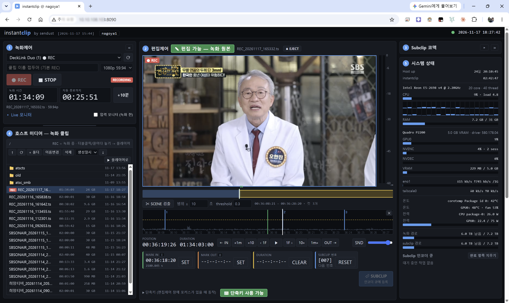

# Playhead 주변 확대 띠: scene change + audio peak

instantclip 편집기에서 만든 기능이다. `✂ SCENE 검출`(단축키 `/`)을 누르면 playhead 앞뒤 ±N초(기본 5)만 서버가 분석해,
그 구간을 확대한 띠에 그린다.



```
 1 ┃                ┃2                        ┃3        ← 컷 번호(1-9 키), 분홍 세로선 = 새 장면의 첫 프레임
 ‥‥┃‥‥‥‥‥‥‥‥‥‥‥‥‥‥‥┃‥‥‥‥‥‥‥‥‥‥‥‥‥‥‥‥‥‥‥‥‥‥‥‥‥┃‥‥‥‥‥‥  ← threshold (노란 점선)
 ▂▃┃▁▂▁▃▂▁▂▁▂▃▁▂▁▂┃▂▁▃▂▁▂▁▃▂▂▁▂▃▁▂▁▂▁▂▁▃▂▁▂▁▃┃▂▁▂▁▃▂  ← 프레임별 scene 점수 (청록 막대, sqrt 스케일)
 ─────────────────────────────────────────────────────
 AUDIO ▆▆▅▆▇▆▆▅▆▆▆▅▆▆▇▆▆▅▆▆▆▅▆▆▆▅▆▆▆▅▆▆▇▆▆▅▃▃▂▆▆▆▅▆▆▆  ← 프레임별 peak dBFS (초록/노랑 −20/빨강 −6)
 44:03     44:04     44:05     44:06 ...                 ← 초 눈금
```

작동하는 구현이 `reference/` 에 있다:

| 파일 | 내용 |
|---|---|
| `reference/scenes.js` | 프런트엔드 전체 (`Scenes` 객체: 요청, canvas 렌더, hover, 클릭 스냅, 숫자키 점프) |
| `reference/media_scenes.py` | 서버: `proxy_timing`, `scenes`(HLS proxy), `_ts_scenes`(원본 TS), `_peaks`(오디오) |
| `reference/scenes.html`, `reference/scenes.css` | 버튼·입력 칸·띠 마크업과 스타일 |

플레이어 쪽 연결(instantclip `web/player.js`)은 세 군데뿐이다: `act("scenes") → Scenes.run()`, 키 처리(아래 §5),
매 animation frame 의 `render()` 에서 `Scenes.render()` 호출(playhead 위치 갱신).

## 1. 설계 원칙

- **필요할 때, 필요한 구간만** 계산한다. 버튼을 눌렀을 때 ±N초(최대 30)만 ffmpeg 로 분석 — 10초 구간 약 0.5~1.3초.
  클립 전체를 미리 분석하지 않는다 (녹화 중인 클립도 바로 쓸 수 있다).
- **편집기가 보여 주는 바로 그 프레임 번호**로 결과를 낸다. 컷이 한 프레임만 어긋나도 subclip 맨 앞/끝에 다른 장면 한 프레임이
  낀다. 이 기능의 대부분의 어려움이 여기 있다 (§3).
- threshold 는 **클라이언트에서만** 거른다. 서버는 모든 프레임의 점수를 주므로 threshold 를 바꾸면 재검출 없이 다시 그린다.
- 컷 = threshold 이상인 프레임 = **새 장면의 첫 프레임**. 그 자리에서 `I` = 새 장면부터 시작, `O` = 이전 장면 마지막 프레임까지
  (out 프레임은 subclip 에 포함되지 않는 규칙일 때).

## 2. 서버: 점수와 peak 구하기

API: `POST /api/clip/scenes {path, t, before, after}` →
`{fps, from, to, frames: [[k, score], ...], peaks: [dB | null, ...]}` (`peaks[i]` = 프레임 `from + i`).

### 2.1 scene 점수 (ffmpeg)

```
ffmpeg -v error -i <input> -map 0:v:0 \
  -vf "scale=320:-2,select='gte(scene,0)',metadata=print:file=-" -an -f null -
```
- `select='gte(scene,0)'` 은 모든 프레임을 통과시키면서 `lavfi.scene_score` 메타데이터를 붙이게 하는 요령이다.
  `metadata=print:file=-` 가 stdout 으로 `frame:N pts:… pts_time:T` 와 `lavfi.scene_score=0.0123` 를 번갈아 찍는다.
- 점수는 바로 앞 프레임과의 차이(0~1). 컷은 **새 장면 첫 프레임 하나만** 높게 나온다. 그래서 구간 첫 프레임의 점수를 내려면
  한 프레임 앞(`f0 - 1`)부터 디코딩해야 한다 (프레임 0 은 점수가 없다).
- `scale=320:-2` 로 줄여서 분석하면 충분히 정확하고 빠르다.

### 2.2 오디오 peak (ffmpeg astats)

```
ffmpeg -v error <input args> -copyts -map 0:a:0 \
  -af "asetnsamples=n=160:p=0,astats=metadata=1:reset=1:measure_perchannel=none:measure_overall=Peak_level,\
ametadata=print:key=lavfi.astats.Overall.Peak_level:file=-" -vn -f null -
```
- 160 샘플(48 kHz 에서 3.3 ms) 조각마다 `pts_time` 과 `Overall.Peak_level`(dBFS, **모든 채널 중 최대 = L·R 합성 하나**)이 나온다.
- 조각을 편집기 프레임으로 모은다: `k = floor((pts_time − zero) × fps)`, 프레임의 peak = 조각들의 최대.
- 무음은 `-inf` → −90 으로 자른다. 오디오 스트림이 없으면 rc≠0 → 전부 `null` 로 돌려준다(scene 점수는 그대로 유효).
- numpy 없이 순수 Python 으로 충분하다 (20초 구간 ≈ 6000 줄).
- 비디오 분석과 **동시에** 돌린다: `asyncio.gather(run_capture(video_args), self._peaks(...))`.

## 3. 프레임 번호 맞추기 — 핵심

편집기 프레임 k 는 플레이어 시계 `[k/fps, (k+1)/fps)` 이고, 플레이어는 mid-frame `(k + 0.5)/fps` 에 세워 둔다.

### 3.1 HLS proxy 로 편집하는 경우 (녹화 클립)

- **비디오: pts 가 아니라 프레임을 센다.** 편집기 프레임 k = proxy HLS 의 k 번째 프레임. playlist 의 `#EXTINF` 길이로
  세그먼트마다 `round(dur × fps)` 프레임을 누적해, 구간 `f0−1 … f1` 을 담은 세그먼트만 `concat:seg1.ts|seg2.ts` 로 넣는다.
  첫 디코딩 프레임 = 그 세그먼트의 첫 프레임 번호 + `shift`.
- `shift`: 플레이어 시계의 0 은 **가장 먼저 시작하는 스트림**(보통 오디오, 비디오보다 ~0.02초 앞)의 pts 다.
  첫 세그먼트를 ffprobe 해 `(min(start_time), video start_time)` 을 얻고
  `shift = max(0, ceil((video_start − zero) × fps − 0.5))`.
- 왜 원본(hires)이 아니라 proxy 인가: 59.94p 원본을 29.97 로 솎으면 seek 위치에 따라 필드-프레임 쌍 중 다른 쪽을 골라
  컷이 한 프레임 어긋난다. 편집기가 보는 proxy 그 자체를 세면 항상 일치한다.
- **오디오는 pts 로**: `-copyts` 로 원래 pts 를 유지하고 `zero` = 위의 플레이어 시계 0 (첫 세그먼트의 가장 이른 start_time).
  concat 프로토콜은 바이트를 이어 붙일 뿐이라 TS pts 가 그대로 나온다.

### 3.2 원본 TS 를 브라우저가 직접 디코딩하는 경우

- 편집기 프레임 k = 원본에서 `pts0 + k 프레임` 의 표시 프레임 (`pts0` = 첫 I-프레임 pts). 원본을
  `-ss <x> -t <len> -i src -copyts` 로 읽고 `k = round((pts_time − pts0/90000) × fps)`.
  입력 seek 는 GOP 경계로 떨어지므로 3초 앞부터 읽고 `f0 ≤ k ≤ f1` 만 남긴다.
- **인터레이스면 편집기가 보여 주는 필드만 분석**: `field=type=top,` (bb/bt 면 bottom) 을 필터 앞에 붙인다.
  두 필드 사이의 컷이 어느 프레임에 잡히는지가 화면과 같아진다.
- 오디오 `zero` = `pts0/90000` (브라우저가 샘플 s 를 frame-0 시각 + s/48000 에 재생하는 것과 같은 시계).

### 3.3 확인 방법

- 컷 프레임에서 정지 → 화면이 새 장면이어야 하고, `,` (−1 프레임) 하면 이전 장면이어야 한다.
- 같은 구간을 다른 경로(proxy vs 원본)로 분석해 컷 번호가 같은지 비교한다.
- 오디오: 소리가 끊기는 컷(뉴스 화면 전환 등)에서 peak 띠의 변화가 컷 선과 같은 프레임에 있어야 한다.

## 4. 프런트엔드: canvas 띠

`reference/scenes.js` 의 `render()` 가 전부다. 요점:

- **프레임 = 같은 폭의 칸**: `slot = width / (to − from + 1)`, 프레임 k 의 x = `(k − from) × slot`.
- **밴드 배치 (위→아래)**: scene 점수(상단, 높이 ~50px) / 구분선 / 오디오(30px) / 초 눈금(14px). 전체 높이 104px.
  컷 선은 두 밴드를 관통해서 컷 지점의 소리 변화가 바로 보이게 한다. mark in/out 은 전체 높이.
- **점수는 sqrt 스케일**: `y = base − sqrt(min(1, s)) × h` — 컷이 아닌 작은 점수도 보이게.
- **오디오는 −60~0 dBFS 선형**, 레벨미터 색 (≤ −20 초록, ≤ −6 노랑, 그 위 빨강), −20/−6 dB 가이드 선.
- **색**: 어두운 배경(#0b0e12)에서 점수 막대 청록(#4fd1c5), 컷 분홍(#ff4fa3), threshold 노란 점선, hover 된 컷 흰색.
  컷 색은 mark in(초록)/out(주황)/playhead(흰)와 겹치지 않게 고른다.
- **다시 그리기 최소화**: `render()` 는 매 animation frame 불리지만, canvas 는 key
  (`width|threshold|markIn|markOut|from|hot`)가 바뀔 때만 다시 그린다. playhead 는 canvas 가 아니라 절대 위치 div 를 옮긴다.
- **HiDPI**: `cv.width = clientWidth × devicePixelRatio` 후 `g.scale(dpr, dpr)`.
- 컷 1~9 에는 번호를 선 오른쪽 위에 그린다 (숫자키와 대응).
- 다른 클립이 열리면 `render()` 에서 `clear()` (data.path 비교).

### 상호작용

- **클릭**: 그 프레임으로 이동 + 정지. 컷에서 6px 이내면 컷으로 **스냅** (`pick()`).
- **hover**: `타임코드  ✂ 컷 (0.62)  ♪ -14.0 dB` 툴팁, 컷 위에선 컷을 흰색으로.
- 버튼(`✂ SCENE 검출`, `✕`)과 canvas 는 `mousedown` 에서 `preventDefault()` — **포커스를 가져가지 않게**.
  run 버튼은 검출 중 disabled 되고 ✕ 는 자기 띠를 숨기므로, 포커스를 가진 채 사라지면 포커스가 편집기 밖으로 빠져
  단축키가 꺼진다. 클릭 후 `Player.box.focus({preventScroll: true})` 로 돌려준다.
- 범위·threshold 는 `localStorage` 에 기억 (try/catch 로 감쌀 것), 초기값은 서버 설정.

## 5. 단축키

```js
// onKey: 입력 칸에서 타이핑 중이면 무시 (scene 범위 숫자 등)
if (e.target.matches("input:not([type=range]), select, textarea")) return;
// "/" (또는 Numpad /) = 검출. Shift+/ (= ?) 는 무시, 키 반복도 무시
Slash: "scenes", NumpadDivide: "scenes",
// 1-9: 띠가 열려 있을 때만 n번째 컷으로, Shift 면 그 한 프레임 앞(이전 장면의 마지막 프레임 → out 찾기)
const digit = !ctrl && /^(Digit|Numpad)([1-9])$/.exec(e.code);
if (digit && Scenes.data) return Scenes.jump(Number(digit[2]), e.shiftKey ? -1 : 0);
```
- `e.code` 로 판별해야 한글 입력 상태에서도 동작하고, Shift+1 이 `!` 가 되어도 `Digit1` 로 잡힌다.
- 점프는 `pause()` 후 `seek((k + off + 0.5) / fps)` — mid-frame 에 세워야 디코딩된 그림과 TC 가 일치한다.
- 없는 컷 번호면 토스트 (`컷 5번이 없습니다 (컷 3개)`).

## 6. 함정 정리

| 증상 | 원인 / 해결 |
|---|---|
| 컷이 한 프레임 늦거나 이르다 | 원본을 솎아서 분석 / pts 반올림 기준이 다름 → 편집기가 보는 소스를 프레임 단위로 세기 (§3) |
| 구간 첫 프레임이 컷인데 안 잡힘 | 한 프레임 앞부터 디코딩하지 않음 (점수는 이전 프레임과의 차이) |
| 인터레이스 원본에서 컷이 가끔 어긋남 | 프레임(두 필드) 단위로 분석 → 편집기가 보여 주는 필드(`field=type=top`)만 |
| 오디오 띠가 영상보다 앞서/뒤처져 보임 | 플레이어 시계 0점을 비디오 시작으로 잡음 → 가장 이른 스트림 start_time (proxy), `-copyts` 필수 |
| 무음 구간에서 파싱 오류 | `Peak_level=-inf` → float("-inf") 를 −90 으로 클램프 |
| 버튼 누른 뒤 단축키가 안 먹음 | 사라지는/비활성화되는 요소가 포커스를 가져감 → mousedown preventDefault + focus 반환 |
| threshold 바꿀 때마다 느림 | 서버 재요청 → 모든 프레임 점수를 받아 클라이언트에서 필터 |
| 숫자키가 다른 기능과 충돌 | 띠가 열려 있을 때(`Scenes.data`)만 가로챈다 |

## 7. 다른 플레이어에 옮길 때 체크리스트

1. 편집기의 "프레임 k" 정의를 먼저 정한다 (어느 소스의 몇 번째 표시 프레임인가, 플레이어 시계 0점은 무엇인가).
2. 서버에서 그 정의 그대로 `[k, score]` 와 `peaks[k − from]` 을 낸다 — 프레임 세기(비디오) / pts−zero(오디오).
3. `reference/scenes.js` 를 가져와 `Player` 의존부만 바꾼다: `Player.clip`, `Player.v.currentTime`, `Player.seek`,
   `Player.markIn/markOut`, `Player.box`, 유틸 `tc()`, `frameOf()`, `FRAME`, `PROXY_FPS`, `$()`, `api()`, `toast()`.
4. 플레이어의 animation-frame 루프에서 `Scenes.render()` 를 부르고, 키 처리에 §5 를 넣는다.
5. §3.3 방법으로 컷 프레임과 오디오 정렬을 실제 클립에서 확인한다.
